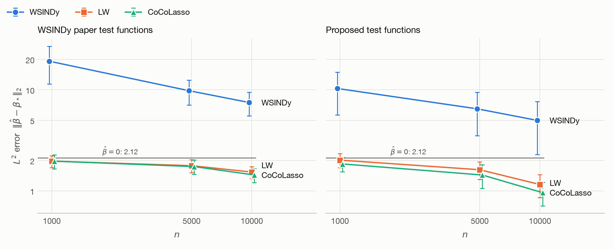
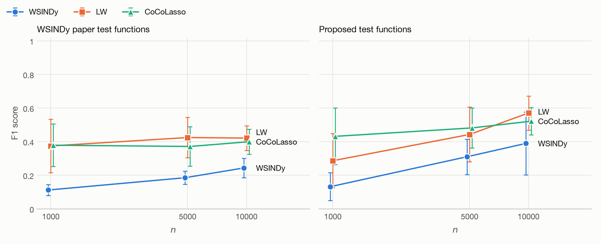

# NLS coefficient estimation: WSINDy, LW, CoCoLasso

100 seeds per setting; seed $i$ draws the data of replication $i$, the same for every method. To reproduce, run `python main.py nls_random_n<n>_<method>[_wsindy_pde]` for each setting, then `python report.py`.

## 1. True PDE

The nonlinear Schrödinger equation with $a = 0.5$, $b = 1$ on $(x, t) \in [-5, 5] \times [0, \pi]$:

$$i\psi_t + a\psi_{xx} + b|\psi|^2\psi = 0, \qquad \psi(x, 0) = 2\,\mathrm{sech}(x).$$

Writing $\psi = u - iv$ gives two equations with three true terms each:

$$u_t = 0.5\,v_{xx} + u^2 v + v^3, \qquad v_t = -0.5\,u_{xx} - u^3 - u v^2.$$

Observations are $U_i = u_*(z_i) + \varepsilon_i$, with $z_i$ uniform on the domain and noise standard deviation $\sigma_c = \rho\,\mathrm{RMS}(u_{*c})$ per component, $\rho = 0.1$.

## 2. Test functions

Both families below have the form

$$\phi_k(x, t) = \Big(1 - \big(\tfrac{x - x_k}{R_x}\big)^2\Big)_+^{p_x} \Big(1 - \big(\tfrac{t - t_k}{R_t}\big)^2\Big)_+^{p_t}.$$

Integrals are Monte Carlo sums with $\Delta z = |\Omega|/n$, and all derivatives are moved onto the test function. The data are random in both cases.

### 2.1 WSINDy paper

The Schrödinger example of Messenger & Bortz (2021), Tables 3 and 4, unchanged at every $n$. Its values are given on a grid of $256 \times 251$: half support $m = (19, 25)$ and query-point stride $s = (5, 5)$ in grid points.

| Item | Value |
|---|---|
| Number | $K = 44 \times 41 = 1804$ (tensor product) |
| Radii | $R_x = 0.742$, $R_t = 0.314$ |
| Degrees | $p_x = 11$, $p_t = 10$ |
| Centers | $x_k = -4.258, \dots, 4.141$ (spacing 0.195), $t_k = 0.314, \dots, 2.827$ (spacing 0.063) |

### 2.2 Proposed

Built from each data set, after Appendix A of Messenger & Bortz (2021), whose spectrum and support need a grid. With $L_x = 10$ and $L_t = \pi$:

1. **Degrees.** $p_a$ is the highest derivative order in coordinate $a$ plus one, so $(p_x, p_t) = (7, 2)$.
2. **Critical modes.** With $N = \sqrt{n}$ modes per coordinate and each component $c$ of $U$, a mode $(k, l)$ is signal if

   $$\frac{\big|\sum_i U_{ci}\, e^{-2\pi i (k x_i/L_x + l t_i/L_t)}\big|^2}{\sum_i U_{ci}^2} > \log\frac{N^2}{0.1}.$$

   The left side has mean one plus the signal, whether the noise floor comes from the $z_i$ or from $\varepsilon_i$. $k_a^*$ is the last signal mode in coordinate $a$, counted up from 1 and stopping at two empty modes in a row.
3. **Radii.** $R_a = \sigma_a\sqrt{2p_a + 3}$ with $\sigma_a = L_a/(2\pi k_a^*)$, averaged over $u$ and $v$, and capped at $L_a/2 - L_a/N$.
4. **Centers.** A tensor lattice of spacing $L_a/50$ in $[\mathrm{lo}_a + R_a, \mathrm{hi}_a - R_a]$, which does not depend on the data.

Median (range) over the seeds:

| $n$ | $R_x$ | $R_t$ | $K$ |
|---|---|---|---|
| 1000 | 1.64 (1.29–2.19) | 0.39 (0.33–0.66) | 1292 (957–1520) |
| 5000 | 1.09 (0.88–1.31) | 0.33 (0.28–0.33) | 1600 (1480–1680) |
| 10000 | 0.94 (0.77–1.09) | 0.33 (0.21–0.33) | 1640 (1600–1848) |

## 3. Dictionary and estimators

$S$ is the highest order of differentiation and $J$ the highest polynomial degree, with $S = J = 6$ as in the Schrödinger example of the paper. The candidate terms of each equation are the constant, and $\partial_x^s(u^p v^q)$ with $s = 0, \dots, S$, $p + q = j$, $j = 1, \dots, J$. That gives $1 + 7 \times 27 = 190$ terms per equation and 380 coefficients in total, of which 6 are nonzero.

| Method | Estimator | Choice of $\lambda$ | Use of $\beta_*$ |
|---|---|---|---|
| WSINDy | MSTLS (Messenger & Bortz 2021), without rescaling | MSTLS loss, 50 values in $10^{-4}$–$1$ | None |
| LW | Loh & Wainwright (2012), eq. (2.7), standardized columns | Corrected 5-fold CV (5.4), 18 values in $0.005$–$1$ | $R$ only: 0.79 ($n=1000$), 0.47 ($n=5000$), 0.43 ($n=10000$) for the paper's test functions; 1.63 ($n=1000$), 1.03 ($n=5000$), 0.91 ($n=10000$) for the proposed ones |
| CoCoLasso | Datta & Zou (2017), eq. (2.1), standardized columns | Same CV and grid as LW | None |

LW's $R$ is an oracle value: the median of $\sqrt{3}\,\|D\beta_*\|_2$ over 20 seeds and both equations. The CV score (5.4) comes from the CoCoLasso paper, and LW uses the same score. LW and CoCoLasso use $\widehat\Sigma_W$, estimated by a sample covariance, so they do not need $\sigma$.

## 4. $L^2$ error

$\|\hat\beta - \beta_*\|_2$ over all 380 coefficients of both equations. The reference line is the value at $\hat\beta = 0$, 2.12. The vertical axis is logarithmic, bars show ±1 sd across seeds, and points are shifted slightly horizontally to avoid overlap.

Mean ± sd (median) over 100 seeds:

| $n$ | Test functions | WSINDy | LW | CoCoLasso |
|---|---|---|---|---|
| 1000 | WSINDy paper | 19.22 ± 7.78 (17.48) | 1.97 ± 0.26 (1.93) | 1.97 ± 0.31 (1.91) |
| 1000 | Proposed | 10.32 ± 4.66 (9.76) | 2.02 ± 0.32 (1.98) | 1.85 ± 0.30 (1.84) |
| 5000 | WSINDy paper | 9.81 ± 2.71 (9.16) | 1.78 ± 0.26 (1.76) | 1.74 ± 0.28 (1.75) |
| 5000 | Proposed | 6.49 ± 2.96 (6.18) | 1.62 ± 0.32 (1.61) | 1.44 ± 0.37 (1.41) |
| 10000 | WSINDy paper | 7.50 ± 1.98 (7.23) | 1.54 ± 0.20 (1.57) | 1.44 ± 0.23 (1.45) |
| 10000 | Proposed | 4.99 ± 2.70 (4.85) | 1.16 ± 0.30 (1.16) | 0.96 ± 0.25 (0.97) |

## 5. F1 score

With $\hat S = \{\ell : \hat\beta_\ell \neq 0\}$ and $S_* = \{\ell : \beta_{*\ell} \neq 0\}$, $F_1 = 2|\hat S \cap S_*|/(|\hat S| + |S_*|)$ over all 380 coefficients of both equations. Bars show ±1 sd across seeds, and points are shifted slightly horizontally to avoid overlap.

Mean ± sd (median) over 100 seeds:

| $n$ | Test functions | WSINDy | LW | CoCoLasso |
|---|---|---|---|---|
| 1000 | WSINDy paper | 0.11 ± 0.03 (0.11) | 0.37 ± 0.16 (0.40) | 0.38 ± 0.13 (0.40) |
| 1000 | Proposed | 0.13 ± 0.08 (0.12) | 0.29 ± 0.16 (0.29) | 0.43 ± 0.17 (0.44) |
| 5000 | WSINDy paper | 0.19 ± 0.04 (0.19) | 0.42 ± 0.12 (0.42) | 0.37 ± 0.12 (0.35) |
| 5000 | Proposed | 0.31 ± 0.11 (0.29) | 0.44 ± 0.16 (0.44) | 0.48 ± 0.12 (0.50) |
| 10000 | WSINDy paper | 0.24 ± 0.06 (0.24) | 0.42 ± 0.07 (0.42) | 0.40 ± 0.07 (0.40) |
| 10000 | Proposed | 0.39 ± 0.19 (0.34) | 0.57 ± 0.10 (0.59) | 0.52 ± 0.08 (0.52) |
