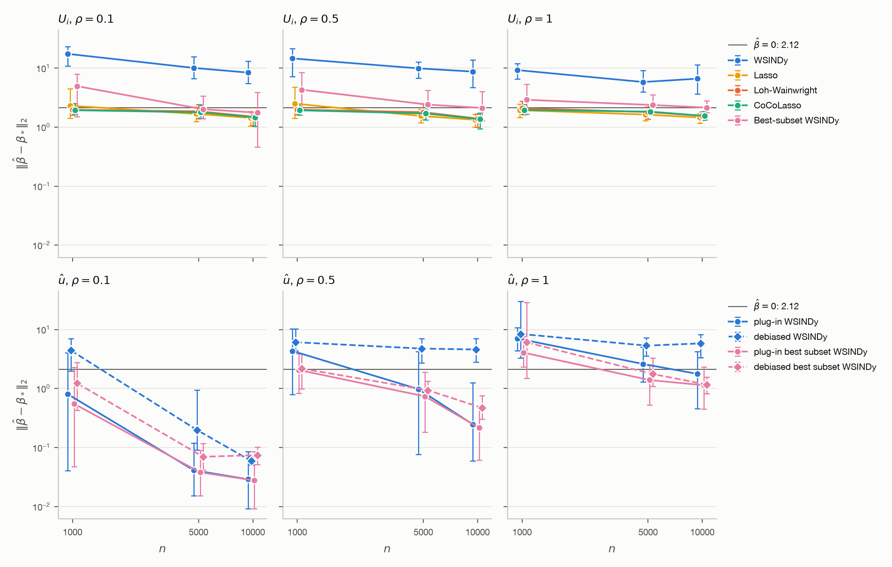
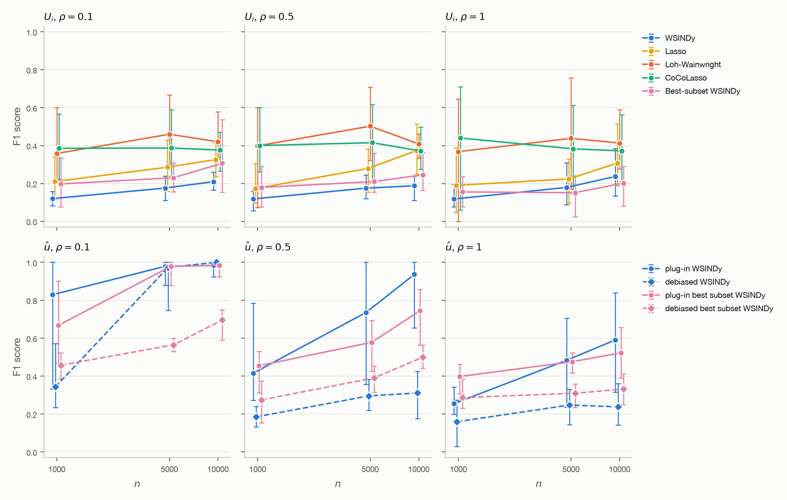

# NLS: the 9 instances of single_instance.ipynb over $n$ and $\rho$

Every instance of `single_instance.ipynb`, for $n = 1000, 5000, 10000$ and $\rho = 0.1, 0.5, 1$. Seed $i$ draws the data of replication $i$, the same for every instance of a setting. The run was stopped after 7 hours, so each setting has only the seeds that finished all 9 instances:

| $n$ | $\rho = 0.1$ | $\rho = 0.5$ | $\rho = 1$ |
|---|---|---|---|
| 1000 | 14 | 14 | 13 |
| 5000 | 14 | 14 | 14 |
| 10000 | 14 | 14 | 14 |

With this few seeds, the 2.5% and 97.5% quantiles below are close to the smallest and largest values. To reproduce, run `python instances.py run --hours 7`, which continues from the saved seeds, then `python report_instances.py`.

## 1. Setup

As in the notebook, with $n$ and $\rho$ varied:

* **PDE and data.** The nonlinear Schrödinger equation with $a = 0.5$, $b = 1$ on $[-5, 5] \times [0, \pi]$, $\psi(x, 0) = 2\thinspace\mathrm{sech}(x)$, three true terms in each of the two equations. $z_i$ uniform on the domain, $U_i = u_*(z_i) + \varepsilon_i$ with $\sigma_c = \rho\thinspace\mathrm{RMS}(u_{*c})$.
* **Test functions.** The Schrödinger example of Messenger & Bortz (2021): $K = 44 \times 41 = 1804$, $R_x = 0.742$, $R_t = 0.314$, $p = (11, 10)$.
* **Dictionary.** The constant and $\partial_x^s(u^p v^q)$, $s = 0, \dots, 6$, $p + q = 1, \dots, 6$: 190 terms per equation.
* **u-hat.** A tanh network of width $(64, 64, 64)$, Adam with learning rate $10^{-3}$ on the full batch, $\kappa = 0$, at most 5000 epochs chosen on 20% held out, then refit on all its observations. u-hat (all n) is fit to all $n$ observations and summed on the $256 \times 251$ grid; u-hat (split) is fit to one half (`data.split()`), and the other half gives the first-order correction of $X^{\mathrm{db}}_n$, $Y^{\mathrm{db}}_n$.

| Instance | Input | Estimator |
|---|---|---|
| WSINDy | U_i | mstls |
| Lasso | U_i | lasso |
| Loh-Wainwright | U_i | lw |
| CoCoLasso | U_i | coco |
| Best-subset WSINDy | U_i | bss |
| plug-in WSINDy | u-hat (all n) | mstls |
| plug-in best subset WSINDy | u-hat (all n) | bss |
| debiased WSINDy | u-hat (split), debiased | mstls |
| debiased best subset WSINDy | u-hat (split), debiased | bss |

* **mstls**: MSTLS of Messenger & Bortz (2021), without their rescaling, $\lambda$ by the MSTLS loss over 50 values in $[10^{-4}, 1]$.
* **lasso**: $\frac{1}{2K}\Vert Y - X\beta\Vert_2^2 + \lambda\Vert D\beta\Vert_1$, $\lambda$ by the MSTLS loss over 50 values on its path.
* **lw**: Loh & Wainwright (2012), eq. (2.7), standardized columns, $\lambda$ by the corrected 5-fold CV of Datta & Zou (2017) over 18 values in $[0.005, 1]$. $R$ is an oracle value, the median of $\sqrt 3\thinspace\Vert D\beta_*\Vert_2$ over 20 seeds and both equations, computed for each $(n, \rho)$:

  | $n$ | $\rho = 0.1$ | $\rho = 0.5$ | $\rho = 1$ |
  |---|---|---|---|
  | 1000 | 0.79 | 0.87 | 1.09 |
  | 5000 | 0.47 | 0.51 | 0.62 |
  | 10000 | 0.43 | 0.46 | 0.53 |

* **coco**: CoCoLasso (Datta & Zou 2017), the same CV, no radius.
* **bss**: best subset selection of Bertsimas, King & Mazumder (2016) for $k = 1, \dots, 10$ by Gurobi, 30 s per MIO, $k$ by the MSTLS loss.

## 2. $L^2$ error

$\Vert\hat\beta - \beta_*\Vert_2$ over the 380 coefficients of both equations; the gray line is its value at $\hat\beta = 0$, 2.12. Points show the mean and bars span the 2.5% to 97.5% quantiles across seeds; the vertical axis is logarithmic. Color shows the estimator; in the bottom row, solid lines are u-hat (all n) and dashed lines u-hat (split), debiased.

Mean (2.5% quantile, 97.5% quantile) over the seeds:

### $\rho = 0.1$

| Instance | $n = 1000$ | $n = 5000$ | $n = 10000$ |
|---|---|---|---|
| WSINDy | 17.44 (10.82, 23.06) | 10.07 (6.66, 15.54) | 8.39 (5.51, 13.02) |
| Lasso | 2.31 (1.41, 4.47) | 1.67 (1.25, 2.19) | 1.44 (1.05, 1.85) |
| Loh-Wainwright | 1.96 (1.61, 2.55) | 1.85 (1.40, 2.43) | 1.51 (1.07, 1.75) |
| CoCoLasso | 1.93 (1.66, 2.49) | 1.78 (1.40, 2.40) | 1.46 (1.03, 1.74) |
| Best-subset WSINDy | 4.95 (1.50, 7.89) | 2.01 (1.39, 3.35) | 1.76 (0.46, 3.88) |
| plug-in WSINDy | 0.80 (0.04, 4.03) | 0.04 (0.02, 0.12) | 0.03 (0.01, 0.09) |
| plug-in best subset WSINDy | 0.55 (0.05, 2.30) | 0.04 (0.02, 0.09) | 0.03 (0.01, 0.09) |
| debiased WSINDy | 4.42 (1.98, 6.98) | 0.20 (0.09, 0.95) | 0.06 (0.05, 0.07) |
| debiased best subset WSINDy | 1.23 (0.43, 2.76) | 0.07 (0.04, 0.12) | 0.07 (0.05, 0.10) |

### $\rho = 0.5$

| Instance | $n = 1000$ | $n = 5000$ | $n = 10000$ |
|---|---|---|---|
| WSINDy | 14.58 (7.15, 21.41) | 9.89 (6.76, 12.77) | 8.74 (4.73, 13.75) |
| Lasso | 2.49 (1.40, 4.77) | 1.54 (1.19, 2.01) | 1.33 (0.99, 1.65) |
| Loh-Wainwright | 1.98 (1.63, 2.49) | 1.79 (1.35, 2.46) | 1.40 (1.00, 1.67) |
| CoCoLasso | 1.93 (1.59, 2.50) | 1.70 (1.32, 2.43) | 1.36 (0.93, 1.73) |
| Best-subset WSINDy | 4.30 (1.95, 8.38) | 2.41 (1.68, 4.19) | 2.11 (1.28, 4.02) |
| plug-in WSINDy | 4.32 (0.79, 10.28) | 0.98 (0.08, 4.26) | 0.25 (0.06, 1.24) |
| plug-in best subset WSINDy | 2.06 (0.84, 3.93) | 0.74 (0.18, 1.90) | 0.22 (0.06, 0.50) |
| debiased WSINDy | 6.09 (4.38, 10.28) | 4.75 (2.70, 7.00) | 4.58 (2.82, 6.99) |
| debiased best subset WSINDy | 2.18 (0.99, 3.85) | 0.94 (0.69, 1.33) | 0.47 (0.30, 0.76) |

### $\rho = 1$

| Instance | $n = 1000$ | $n = 5000$ | $n = 10000$ |
|---|---|---|---|
| WSINDy | 9.26 (6.50, 11.86) | 5.81 (3.95, 9.13) | 6.62 (3.62, 11.42) |
| Lasso | 1.94 (1.45, 2.45) | 1.63 (1.28, 1.89) | 1.45 (1.17, 1.72) |
| Loh-Wainwright | 2.09 (1.67, 2.76) | 1.80 (1.38, 2.19) | 1.55 (1.30, 1.83) |
| CoCoLasso | 1.95 (1.63, 2.43) | 1.83 (1.62, 2.22) | 1.55 (1.33, 1.84) |
| Best-subset WSINDy | 2.90 (1.66, 5.36) | 2.37 (1.77, 3.51) | 2.14 (1.77, 2.78) |
| plug-in WSINDy | 7.06 (4.38, 10.75) | 2.60 (1.30, 5.07) | 1.77 (0.46, 4.22) |
| plug-in best subset WSINDy | 4.05 (2.34, 7.60) | 1.39 (0.53, 2.49) | 1.14 (0.45, 2.32) |
| debiased WSINDy | 8.42 (3.30, 29.97) | 5.33 (3.57, 7.24) | 5.82 (3.32, 8.28) |
| debiased best subset WSINDy | 6.06 (1.49, 28.48) | 1.76 (1.09, 3.30) | 1.17 (0.81, 1.57) |

## 3. F1 score

$F_1 = 2|\hat S \cap S_*|/(|\hat S| + |S_*|)$ over the 380 coefficients of both equations, with $\hat S$ and $S_*$ the nonzero entries of $\hat\beta$ and $\beta_*$.

Mean (2.5% quantile, 97.5% quantile) over the seeds:

### $\rho = 0.1$

| Instance | $n = 1000$ | $n = 5000$ | $n = 10000$ |
|---|---|---|---|
| WSINDy | 0.12 (0.08, 0.16) | 0.18 (0.11, 0.24) | 0.21 (0.16, 0.26) |
| Lasso | 0.21 (0.11, 0.34) | 0.29 (0.16, 0.43) | 0.33 (0.24, 0.41) |
| Loh-Wainwright | 0.36 (0.21, 0.60) | 0.46 (0.30, 0.67) | 0.42 (0.34, 0.58) |
| CoCoLasso | 0.39 (0.22, 0.57) | 0.39 (0.24, 0.59) | 0.38 (0.27, 0.47) |
| Best-subset WSINDy | 0.20 (0.08, 0.33) | 0.23 (0.16, 0.31) | 0.31 (0.15, 0.54) |
| plug-in WSINDy | 0.83 (0.33, 1.00) | 0.98 (0.88, 1.00) | 0.98 (0.92, 1.00) |
| plug-in best subset WSINDy | 0.67 (0.47, 0.90) | 0.98 (0.88, 1.00) | 0.98 (0.92, 1.00) |
| debiased WSINDy | 0.34 (0.23, 0.57) | 0.97 (0.75, 1.00) | 1.00 (1.00, 1.00) |
| debiased best subset WSINDy | 0.46 (0.38, 0.52) | 0.56 (0.53, 0.60) | 0.69 (0.59, 0.75) |

### $\rho = 0.5$

| Instance | $n = 1000$ | $n = 5000$ | $n = 10000$ |
|---|---|---|---|
| WSINDy | 0.12 (0.06, 0.16) | 0.18 (0.12, 0.24) | 0.19 (0.11, 0.24) |
| Lasso | 0.17 (0.10, 0.30) | 0.28 (0.15, 0.38) | 0.37 (0.25, 0.51) |
| Loh-Wainwright | 0.40 (0.07, 0.60) | 0.50 (0.32, 0.71) | 0.41 (0.33, 0.46) |
| CoCoLasso | 0.40 (0.26, 0.60) | 0.42 (0.21, 0.62) | 0.37 (0.27, 0.50) |
| Best-subset WSINDy | 0.18 (0.08, 0.29) | 0.21 (0.15, 0.36) | 0.25 (0.16, 0.36) |
| plug-in WSINDy | 0.41 (0.27, 0.78) | 0.74 (0.36, 1.00) | 0.94 (0.65, 1.00) |
| plug-in best subset WSINDy | 0.45 (0.31, 0.53) | 0.58 (0.43, 0.69) | 0.74 (0.56, 0.86) |
| debiased WSINDy | 0.18 (0.13, 0.24) | 0.30 (0.22, 0.38) | 0.31 (0.18, 0.42) |
| debiased best subset WSINDy | 0.27 (0.15, 0.37) | 0.39 (0.32, 0.45) | 0.50 (0.44, 0.56) |

### $\rho = 1$

| Instance | $n = 1000$ | $n = 5000$ | $n = 10000$ |
|---|---|---|---|
| WSINDy | 0.12 (0.08, 0.20) | 0.18 (0.09, 0.31) | 0.24 (0.13, 0.38) |
| Lasso | 0.19 (0.05, 0.39) | 0.22 (0.10, 0.33) | 0.31 (0.19, 0.51) |
| Loh-Wainwright | 0.37 (0.00, 0.65) | 0.44 (0.17, 0.76) | 0.41 (0.28, 0.59) |
| CoCoLasso | 0.44 (0.06, 0.71) | 0.38 (0.15, 0.61) | 0.37 (0.21, 0.56) |
| Best-subset WSINDy | 0.16 (0.08, 0.24) | 0.15 (0.03, 0.24) | 0.20 (0.08, 0.29) |
| plug-in WSINDy | 0.25 (0.20, 0.34) | 0.48 (0.24, 0.71) | 0.59 (0.32, 0.84) |
| plug-in best subset WSINDy | 0.40 (0.31, 0.46) | 0.48 (0.42, 0.52) | 0.52 (0.39, 0.66) |
| debiased WSINDy | 0.16 (0.03, 0.27) | 0.25 (0.14, 0.33) | 0.24 (0.14, 0.36) |
| debiased best subset WSINDy | 0.29 (0.23, 0.38) | 0.31 (0.23, 0.36) | 0.33 (0.25, 0.41) |

## 4. Irrepresentable condition

For one equation with true terms $S$ and Gram matrix $C$ of the standardized columns, $\eta = \Vert C_{S^cS} C_{SS}^{-1}\mathrm{sign}(\beta_{*,S})\Vert_\infty$ (Zhao & Yu 2006) and its sign-free version $\mu = \Vert C_{S^cS} C_{SS}^{-1}\Vert_\infty$ (Wainwright 2009). The lasso can select $S$ with the correct signs only if $\eta < 1$. Each cell is the median $\eta$ / median $\mu$ over the seeds and both equations, and in parentheses the share of $\eta < 1$.

### $\rho = 0.1$

| Gram matrix | $n = 1000$ | $n = 5000$ | $n = 10000$ |
|---|---|---|---|
| $X(u_*)$ on the grid, reference | 1.47 / 1.71 (0%) | 1.47 / 1.71 (0%) | 1.47 / 1.71 (0%) |
| $X_n(U)$ | 1.13 / 1.32 (0%) | 1.25 / 1.29 (0%) | 1.33 / 1.34 (0%) |
| $X_n(U)$, $X'X/K - \widehat\Sigma_W$ | 2.65 / 3.10 (0%) | 3.91 / 3.91 (0%) | 2.11 / 2.11 (0%) |
| $X_n(\hat u)$, u-hat (all n) | 1.42 / 1.66 (0%) | 1.46 / 1.71 (0%) | 1.47 / 1.71 (0%) |
| $X^{\mathrm{db}}_n(\hat u)$, u-hat (split) | 1.39 / 1.41 (0%) | 1.39 / 1.61 (0%) | 1.43 / 1.66 (0%) |

### $\rho = 0.5$

| Gram matrix | $n = 1000$ | $n = 5000$ | $n = 10000$ |
|---|---|---|---|
| $X(u_*)$ on the grid, reference | 1.47 / 1.71 (0%) | 1.47 / 1.71 (0%) | 1.47 / 1.71 (0%) |
| $X_n(U)$ | 1.12 / 1.37 (0%) | 1.21 / 1.32 (0%) | 1.29 / 1.39 (0%) |
| $X_n(U)$, $X'X/K - \widehat\Sigma_W$ | 2.63 / 3.21 (0%) | 3.33 / 3.41 (0%) | 2.11 / 2.11 (0%) |
| $X_n(\hat u)$, u-hat (all n) | 1.31 / 1.53 (0%) | 1.39 / 1.63 (0%) | 1.42 / 1.67 (0%) |
| $X^{\mathrm{db}}_n(\hat u)$, u-hat (split) | 1.10 / 1.23 (4%) | 1.30 / 1.32 (0%) | 1.37 / 1.38 (0%) |

### $\rho = 1$

| Gram matrix | $n = 1000$ | $n = 5000$ | $n = 10000$ |
|---|---|---|---|
| $X(u_*)$ on the grid, reference | 1.47 / 1.71 (0%) | 1.47 / 1.71 (0%) | 1.47 / 1.71 (0%) |
| $X_n(U)$ | 1.10 / 1.41 (0%) | 1.15 / 1.43 (0%) | 1.21 / 1.51 (0%) |
| $X_n(U)$, $X'X/K - \widehat\Sigma_W$ | 3.07 / 6.77 (0%) | 3.17 / 3.17 (0%) | 2.36 / 2.36 (0%) |
| $X_n(\hat u)$, u-hat (all n) | 1.27 / 1.49 (0%) | 1.32 / 1.55 (0%) | 1.37 / 1.60 (0%) |
| $X^{\mathrm{db}}_n(\hat u)$, u-hat (split) | 1.03 / 1.16 (12%) | 1.13 / 1.24 (0%) | 1.20 / 1.27 (0%) |

## 5. u-hat and the weak forms

Median over the seeds of the number of epochs and of $\Vert\hat u - u_*\Vert_{L^2(\Omega)}/\Vert u_*\Vert_{L^2(\Omega)}$, for $u$ and $v$:

| $n$ | $\rho$ | seeds | epochs, all $n$ | epochs, split | rel. $L^2$ error, all $n$ | rel. $L^2$ error, split |
|---|---|---|---|---|---|---|
| 1000 | 0.1 | 14 | 1480 | 1829 | 0.057, 0.059 | 0.113, 0.118 |
| 1000 | 0.5 | 14 | 600 | 604 | 0.176, 0.184 | 0.271, 0.262 |
| 1000 | 1 | 13 | 501 | 451 | 0.322, 0.330 | 0.460, 0.444 |
| 5000 | 0.1 | 14 | 2900 | 2478 | 0.023, 0.023 | 0.032, 0.032 |
| 5000 | 0.5 | 14 | 896 | 701 | 0.083, 0.087 | 0.113, 0.113 |
| 5000 | 1 | 14 | 643 | 586 | 0.145, 0.144 | 0.199, 0.194 |
| 10000 | 0.1 | 14 | 4086 | 2548 | 0.017, 0.017 | 0.024, 0.023 |
| 10000 | 0.5 | 14 | 1130 | 792 | 0.064, 0.064 | 0.087, 0.083 |
| 10000 | 1 | 14 | 819 | 687 | 0.111, 0.112 | 0.148, 0.145 |

Median over the seeds and both equations of $\Vert A - A(u_*)\Vert/\Vert A(u_*)\Vert$, for $X$ on the true terms and for $Y$, with $A(u_*)$ from $u_*$ summed on the $256 \times 251$ grid:

| $n$ | $\rho$ | seeds | $X$ true terms, U_i | $X$ true terms, u-hat (all n) | $X$ true terms, u-hat (split), debiased | $Y$, U_i | $Y$, u-hat (all n) | $Y$, u-hat (split), debiased |
|---|---|---|---|---|---|---|---|---|
| 1000 | 0.1 | 14 | 2.90 | 0.14 | 0.64 | 1.34 | 0.07 | 0.28 |
| 1000 | 0.5 | 14 | 3.13 | 0.34 | 2.21 | 1.47 | 0.21 | 1.00 |
| 1000 | 1 | 13 | 3.99 | 0.54 | 4.34 | 1.80 | 0.38 | 1.93 |
| 5000 | 0.1 | 14 | 1.29 | 0.05 | 0.18 | 0.59 | 0.03 | 0.08 |
| 5000 | 0.5 | 14 | 1.43 | 0.18 | 0.89 | 0.65 | 0.11 | 0.40 |
| 5000 | 1 | 14 | 1.78 | 0.29 | 1.77 | 0.80 | 0.18 | 0.80 |
| 10000 | 0.1 | 14 | 0.94 | 0.03 | 0.13 | 0.42 | 0.02 | 0.06 |
| 10000 | 0.5 | 14 | 1.03 | 0.13 | 0.63 | 0.46 | 0.08 | 0.28 |
| 10000 | 1 | 14 | 1.28 | 0.21 | 1.25 | 0.57 | 0.14 | 0.56 |

## 6. Best subset: certified optimal MIOs

Share of the paths, over all settings, seeds and both equations, whose MIO at $k$ ended with a gap of at most $10^{-4}$ within 30 s.

| Input | $k = 1$ | $k = 2$ | $k = 3$ | $k = 4$ | $k = 5$ | $k = 6$ | $k = 7$ | $k = 8$ | $k = 9$ | $k = 10$ |
|---|---|---|---|---|---|---|---|---|---|---|
| U_i | 100% | 100% | 91% | 16% | 0% | 0% | 0% | 0% | 0% | 0% |
| u-hat (all n) | 100% | 100% | 100% | 87% | 0% | 0% | 0% | 0% | 0% | 0% |
| u-hat (split), debiased | 100% | 100% | 99% | 67% | 23% | 0% | 0% | 0% | 0% | 0% |

## 7. Run time

Median minutes per seed with one thread, both equations together, over the three $\rho$ of each $n$; 10 seeds ran at a time on a 10-core Apple M4.

| Step | $n = 1000$ | $n = 5000$ | $n = 10000$ |
|---|---|---|---|
| PINN, u-hat (all n) | 0.5 | 2.4 | 4.5 |
| PINN, u-hat (split) | 0.3 | 1.1 | 2.3 |
| WSINDy | 0.0 | 0.1 | 0.1 |
| Lasso | 3.9 | 1.1 | 0.9 |
| Loh-Wainwright | 0.4 | 0.6 | 0.9 |
| CoCoLasso | 5.0 | 1.6 | 1.4 |
| Best-subset WSINDy | 8.2 | 7.8 | 7.8 |
| plug-in WSINDy | 0.0 | 0.0 | 0.0 |
| plug-in best subset WSINDy | 7.1 | 6.7 | 6.6 |
| debiased WSINDy | 0.0 | 0.0 | 0.0 |
| debiased best subset WSINDy | 7.6 | 7.3 | 7.0 |
